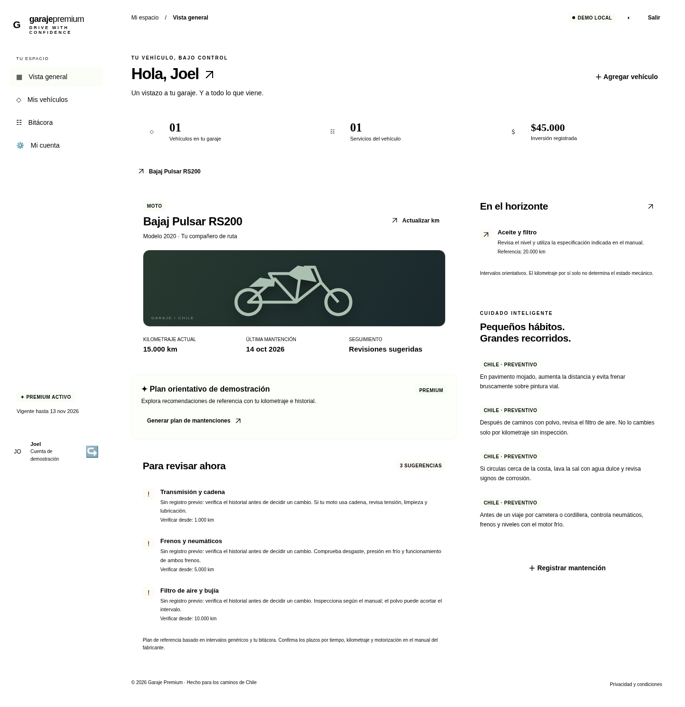

# Garaje Premium

Aplicación web para Chile: acceso obligatorio, suscripción simulada, varios vehículos, bitácora de mantenciones, gastos en CLP y planes preventivos. HTML5, CSS3, Tailwind por CDN y JavaScript ES modules, sin framework ni proceso de compilación para el frontend.

## Probar sin instalar herramientas

Descarga `demo.html` y ábrelo con tu navegador. Es una versión autónoma de la demo: incluye HTML, estilos y JavaScript en un solo archivo y no necesita descargar dependencias externas. Crea una cuenta de prueba y activa la suscripción simulada para recorrer el garaje. Si tu navegador corporativo bloquea archivos locales, utiliza el servidor descrito abajo. Los datos de esta demo se guardan solo en ese navegador; la IA y el pago son simulados.

`demo.html` es una instantánea generada del frontend; los archivos modulares de raíz siguen siendo el código fuente para desarrollar y conectar Supabase.

Para regenerar la demo después de modificar el frontend:

```bash
npm exec --yes --package esbuild@0.25.12 -- esbuild app.js --bundle --format=iife --target=es2022 --outfile=/tmp/garaje-demo-bundle.js
python3 scripts/build-demo.py /tmp/garaje-demo-bundle.js
```

Con el servidor activo, prueba el archivo autónomo y sus estilos sin permitir dependencias de red:

```bash
GARAJE_URL=http://127.0.0.1:5173/demo.html CHROMIUM_PATH=/usr/bin/chromium python3 tests/browser_test.py
```

## Así se ve la demo

Captura real del panel con datos ficticios y una Bajaj Pulsar RS200:



[Ver captura móvil](docs/movil.png).

## Ejecutar en Visual Studio Code

1. Abre esta carpeta en VS Code.
2. Inicia el servidor desde una terminal:

```bash
python3 -m http.server 5173
```

En Windows, si corresponde:

```powershell
py -m http.server 5173
```

También puedes usar la extensión **Live Server**, o ejecutar `npm start` si tienes Node.js y Python 3. Accede al puerto 5173 de tu máquina. No abras `index.html` con `file://`: los módulos y la autenticación necesitan un servidor HTTP. En producción, utiliza HTTPS.

La configuración predeterminada es una **demo local funcional**: crea una cuenta con datos ficticios, activa la prueba de 30 días y agrega un vehículo. No hay cobros, correos ni llamadas a IA en este modo. Los registros sobreviven a una recarga y cada cuenta demo tiene su propio garaje. Los datos se guardan en localStorage; cualquier persona con acceso al navegador puede alterarlos. Las contraseñas demo se derivan con PBKDF2 y sal aleatoria, pero esto no reemplaza autenticación de servidor. No uses una contraseña real.

No se requiere `npm install` para ejecutar el frontend. Los estilos propios permiten utilizarlo aunque Tailwind o las fuentes externas no carguen.

## Archivos

| Archivo | Contenido |
| --- | --- |
| `index.html` | Documento, dependencias CDN y punto de entrada |
| `styles.css` | Diseño responsive, temas oscuro/claro, tarjetas, formularios y diálogos |
| `config.js` | Configuración pública y selección del modo demo |
| `catalog.js` | Tipos → marcas → modelos → años, formato y validación del odómetro |
| `api.js` | Autenticación, persistencia y conexión con Supabase |
| `planner.js` | Motor orientativo por reglas, exclusivo de la demo |
| `app.js` | Vistas, navegación, formularios, bitácora y exportación CSV |
| `supabase/schema.sql` | Tablas, catálogo, RLS, funciones, triggers e índices |
| `supabase/functions/maintenance-plan/index.ts` | IA real desde el servidor, autenticación y cuota |
| `supabase/config.toml` | Configuración de la Edge Function |
| `tests/` | Pruebas de dominio, navegador y PostgreSQL embebido |

## Conectar Supabase

### 1. Crear el esquema

Crea un proyecto de Supabase. Ejecuta **todo** `supabase/schema.sql` en su SQL Editor. Está preparado para un proyecto nuevo y puede repetirse con esta versión. Incluye:

- Perfil creado automáticamente al registrarse; membresía protegida contra escritura del cliente.
- Vehículos restringidos al catálogo y a su rango de años.
- Kilometraje entero de 0 a 999.999, sin disminuciones del odómetro.
- Registros históricos con fecha entre el año del vehículo y hoy, considerando Chile.
- Guardado transaccional de mantención y actualización del odómetro.
- RLS y claves compuestas para aislar vehículos y servicios entre usuarios.
- Eliminación en cascada y cuota IA atómica: una petición cada 30 segundos, hasta 20 al día (día de servidor).

Las notas y el taller no se envían al proveedor de IA. La función envía únicamente datos técnicos del vehículo y categorías, fechas y kilometrajes de hasta 40 servicios recientes.

### 2. Configurar las claves públicas

Edita `config.js` con la **Project URL** y la **publishable key o anon key** del proyecto, disponibles en su configuración API. Cambia `demo` a `false`. La clave pública se puede usar en el navegador porque el acceso a datos está protegido por RLS.

Nunca coloques una clave `service_role`, una clave secreta de Supabase o la clave de IA en archivos del frontend. No hay secretos incluidos en este repositorio.

### 3. Autenticación y proveedores

En Supabase → Authentication → URL Configuration:

- Configura **Site URL** con la dirección real de la aplicación.
- Añade el origen y ruta de desarrollo y producción a **Redirect URLs**. Si usas Live Server, incluye su puerto.
- Habilita Email/Password. Con confirmación activada, primero se debe abrir el enlace recibido por correo; el frontend muestra ese paso.
- Para Google, Apple y Microsoft (Azure), configura cada proveedor en Authentication → Providers con sus credenciales y callback de Supabase. Los botones ya invocan el proveedor correspondiente. Microsoft solicita el scope `email`.
- Configura SMTP para una entrega fiable de confirmaciones y recuperación de contraseña en producción.

La recuperación se solicita desde «¿La olvidaste?» después de escribir el correo. El enlace vuelve a la aplicación y abre el formulario de nueva contraseña.

### 4. Habilitar la suscripción simulada

La simulación viene **desactivada en el servidor**, aunque el botón de la demo esté habilitado. Para probarla con Supabase, ejecuta en SQL Editor:

```sql
update public.app_settings
set payment_simulation_enabled = true
where id = true;
```

Mantén `enablePaymentSimulation: true` en `config.js`. La RPC autenticada activa 30 días y rechaza renovar mientras la membresía siga vigente. No pide tarjeta, no cobra y no se renueva automáticamente. El precio de $4.990 CLP/mes es ilustrativo.

Para desactivarla:

```sql
update public.app_settings
set payment_simulation_enabled = false
where id = true;
```

Cambia también `enablePaymentSimulation` a `false` para ocultar la activación desde el flujo de pago. No se incluye una integración comercial real, conforme a la alternativa de simulación solicitada. Si conectas Mercado Pago, Flow u otro proveedor, actualiza `profiles.premium_until` únicamente desde un backend que valide firma, monto, moneda, usuario, estado e idempotencia del webhook. Nunca habilites una política que permita al usuario editar su membresía.

### 5. Activar IA real

Instala Supabase CLI según su documentación y vincula el proyecto desde esta carpeta:

```bash
supabase login
supabase link --project-ref TU_PROJECT_REF
supabase functions deploy maintenance-plan
```

`supabase/config.toml` desactiva la validación JWT del gateway para esta función porque **el código verifica explícitamente la identidad con `auth.getUser()`** y consulta los datos con el JWT del usuario. No se usa `service_role` ni se confía en un ID de usuario enviado por el cliente.

En Supabase → Edge Functions → Secrets configura de forma segura:

| Nombre | Valor |
| --- | --- |
| `AI_API_KEY` | Clave privada del proveedor OpenAI |
| `AI_MODEL` | Opcional; por defecto `gpt-4o-mini`, debe admitir Structured Outputs |
| `ALLOWED_ORIGIN` | Origen exacto del frontend, incluyendo protocolo y puerto, sin barra final |

`SUPABASE_URL` y `SUPABASE_ANON_KEY` son variables proporcionadas por la plataforma de Edge Functions. El origen predeterminado es `http://localhost:5173`. Usa el mismo nombre de host al abrir el frontend: `127.0.0.1` y `localhost` son orígenes distintos.

La función comprueba usuario, membresía y propiedad del vehículo, limita solicitudes, consulta el historial y valida la respuesta estructurada. Ante errores muestra un mensaje; nunca presenta el motor demo como una respuesta real de IA. Las peticiones que llegan al proveedor consumen cuota aunque el proveedor falle. También debes configurar límites de gasto en tu cuenta del proveedor.

**La IA requiere una cuenta con acceso al modelo y facturación del proveedor.** No ha sido desplegada ni llamada a un servicio real durante la entrega, porque no se han proporcionado proyecto ni credenciales.

## Catálogo chileno y años

Incluye marcas comercializadas en Chile para automóviles, camionetas y motos, con modelos predefinidos (incluida Bajaj Pulsar RS200) y años seleccionables hasta **2026**. Cambiar tipo o marca limpia las selecciones dependientes. No se aceptan camiones, modelos libres ni años fuera del rango de cada entrada. El servidor vuelve a validar el rango.

**Limitación de datos:** los años de inicio incluidos son referencias iniciales, no un registro certificado de la primera venta o importación comercial en Chile. La validación informática del rango está implementada, pero la exactitud histórica de esos límites requiere contrastar cada modelo con documentación del distribuidor chileno. No se debe anunciar esa exactitud como verificada. El catálogo es acotado y no representa todas las generaciones, versiones o vehículos del país.

Para incorporar o corregir un modelo, actualiza `catalog.js` y la fila correspondiente de `public.vehicle_catalog`. Antes de cambiar límites de modelos existentes, revisa los vehículos ya registrados. No confundas año de lanzamiento internacional con primera comercialización en Chile. El corte 2026 es explícito en frontend y SQL, como solicita esta versión.

## Planes de mantenimiento

- **Demo:** reglas genéricas, señaladas como orientación. Usa historial de categorías y kilometraje, distingue tareas sin registro y próximas referencias. No inventa especificaciones oficiales por marca ni estado mecánico.
- **Supabase:** respuesta de IA con datos reales de ese usuario y vehículo. No existe un diagnóstico mecánico ni un porcentaje de salud calculado únicamente a partir del odómetro.
- Ambos modos indican que deben revisarse manual, motorización, tiempo transcurrido y condición real antes de intervenir. Para recomendaciones oficiales hacen falta manuales verificados por versión; no se incluyen en el repositorio.

## Validación

Con Node.js 20 o superior:

```bash
npm run check
npm test
```

Con Node.js 24 o superior, también puedes probar el código real de la Edge Function con autenticación y transporte simulados (sin llamadas externas):

```bash
npm run test:edge
```

Prueba de navegador de la demo (con el servidor activo y Playwright instalado):

```bash
python3 -m pip install playwright
python3 -m playwright install chromium
python3 tests/browser_test.py
```

Si ya tienes Chromium, puedes evitar descargarlo usando `CHROMIUM_PATH` con la ruta de su ejecutable. Las capturas de esta prueba se escriben en `/tmp/garaje-dashboard.png` y `/tmp/garaje-mobile.png`; ajusta esas rutas si ejecutas en Windows.

Para validar SQL, RPC y RLS con PostgreSQL embebido en un entorno de pruebas aislado:

```bash
npm install --prefix /tmp/garaje-validation --cache /tmp/garaje-npm-cache @electric-sql/pglite@0.3.14 --no-audit --no-fund
PGLITE_MODULE=/tmp/garaje-validation/node_modules/@electric-sql/pglite/dist/index.js node tests/database.test.mjs
```

Esta prueba crea una base efímera y un esquema de autenticación de prueba: verifica SQL idempotente, protección de membresía, aislamiento de dos usuarios, transacciones, fechas, odómetro, cuota y cascada. No reemplaza la comprobación de OAuth, correo y Edge Functions en tu proyecto Supabase.

Validado durante la entrega: pruebas de dominio, flujo E2E de demo en Chromium, diseño a 390 px sin desbordamiento horizontal pruebas de PostgreSQL embebido y dos pruebas de la Edge Function con servicios simulados. Pendientes de configuración externa: Supabase alojado, OAuth, correo y llamadas reales de IA. La simulación no equivale a una pasarela validada.

## Publicación

El frontend se puede alojar como archivos estáticos. Incluye todos los archivos de raíz usados por `index.html`. No incluyas archivos privados de entorno. Configura HTTPS, URLs autorizadas de Supabase y `ALLOWED_ORIGIN` de la función con la dirección publicada. Tailwind, Supabase JS y las fuentes se descargan de sus CDN; para despliegues con restricciones estrictas puedes alojar esas dependencias localmente.

Antes de comercializar: valida el catálogo chileno, despliega y prueba los proveedores reales, integra la pasarela si cobrarás, y completa la política de privacidad/condiciones con la identidad del responsable y las condiciones comerciales del servicio.

## Mapa de producto del Hito 1

La [diapositiva editable](docs/mapa-producto/Mapa-de-producto-editable.pptx) y la [presentación con el mapa agregado](docs/mapa-producto/Presentacion-con-mapa-de-producto.pptx) muestran el recorrido de la propuesta original. También están disponibles la [vista previa](docs/mapa-producto/mapa-de-producto.png) y la [guía de implementación](docs/mapa-producto/GUIA_DE_IMPLEMENTACION.md). La guía distingue el alcance de esa presentación del estado actual de este repositorio.
